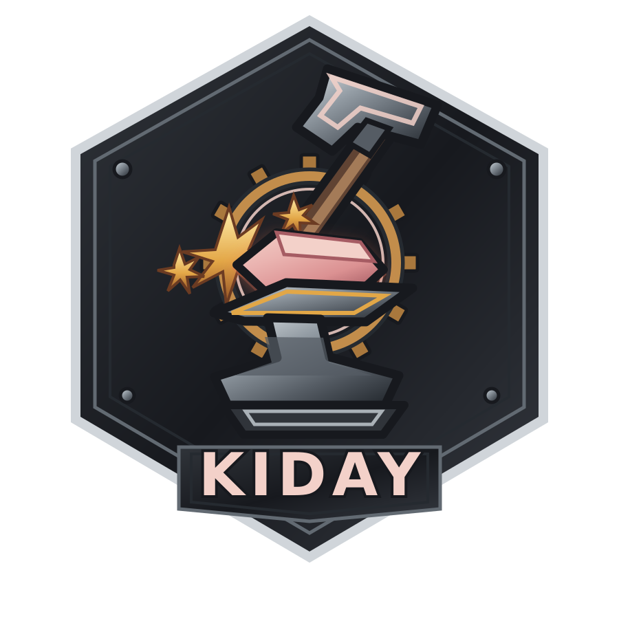

<div align="center">
  
  <h1>Create: Kiday</h1>
  <p>A Create-powered metallurgy and adventure addon for Minecraft 1.21.1.</p>
</div>

Create: Kiday adds Kiday and Salur metallurgy to Create, including shared casting molds, heated castings, and new equipment. Explore the Lightning Engine, LeiGong's Replica, and Storm Spirits in the Storm Grove.

**Version:** 1.4.0 · **License:** MIT.

## Screenshots

<p align="center">
  
  
</p>
<p align="center">
  
  
</p>

## Requirements

- Minecraft 1.21.1
- NeoForge 21.1.266 or later in the 21.1 line
- Create 6.0.x
- Curios 9.2.2 or later
- JEI 19.x (optional)

Install Create: Kiday 1.4.0 and its required dependencies on both the client and server.

## Getting started

1. Find Kiday in the Overworld and Salur between Y=0 and Y=64. Salur generates throughout the Overworld, including beneath Storm Grove.
2. Process Raw Kiday or Raw Salur in a heated Create Basin. Each ingot uses 144 mB of its matching molten metal.
3. Shape a Blank Pattern with a Deployer, then use it on the shared Casting Table. Kiday and Salur use the same mold shapes; the metal is recorded on each hot casting.
4. Cool hot castings with Bulk Washing. Use the appropriate metal's cooled piece to craft equipment.
5. Craft a Disk Mold to cast a returning Salur Disc. Combine it with TNT for a TNT Disc. LeiGong's Core and Salur Sheets craft the Lightning Staff Head.

The Casting Table recipe uses three Iron Sheets across the top row, two Create Fluid Pipes around a Create Basin in the middle row, and three Andesite Alloys along the bottom row.

## Features

- **Kiday and Salur metallurgy:** ores, ingots, sheets, placeable molten fluids, shared molds, exact-volume casting, and cooled hot castings with a separate metal data component.
- **Tools and armor:** Kiday and Salur equipment, with Kiday abilities and a Salur armor movement bonus.
- **Discs:** a returning, piercing Salur Disc and a TNT Disc. Creative throws do not consume disc durability or stacks.
- **Biomass Generator:** burns tagged biomass fuels to generate Create rotation from 8 to 64 RPM, with automatic item input and output.
- **Lightning Staff:** LeiGong-style lightning on left click and a 6 HP melee strike on right click, with a three-second cooldown and Kiday tool durability.
- **Lightning Engine:** redirects lightning in its loaded chunk to its custom rod, then generates Create rotation for a limited charge. Select 16, 32, 64, or 128 RPM with the Create value box on its back; power exits through the horizontal shaft on the front.
- **Storm Grove:** LeiGong's Replica uses three health phases and a persistent, region-based boss spawn record. Neutral Storm Spirits spawn in the grove, use Minecraft's Blaze model and animation, and have a LeiGong-palette texture and spawn egg.
- **Advancements:** 21 advancements, with 20 visible progression milestones and one hidden completion achievement.
- **Removed in 1.4.0:** Hunter Bracelet, its components and mold, and its automatic targeting system. Worlds and items from earlier releases are not backward compatible.
- **Kiday Chronicle:** read the story behind the metal and its smith.
- **Create integration:** Ponder scenes and JEI recipe displays explain the production and machine workflows.

## Documentation and development

See [CONTRIBUTING.md](CONTRIBUTING.md) for setup, texture conventions, and contribution checks.

Use Java 21, Python 3, and Pillow 12.3.0 for deterministic pixel-art generation and texture checks. The checked-in Gradle wrapper provides separate commands for each test group:

```bash
./gradlew build
./gradlew test
./gradlew unitTest
./gradlew integrationTest
./gradlew gameTests
./gradlew endToEndTest
./gradlew smokeTest
./gradlew regressionTest
./gradlew resourceValidationTest
./gradlew textureDeterminism
./gradlew jacocoTestReport
./gradlew allTests
./gradlew runGameTestServer
./gradlew runClient -PkidayClientSmokeTest
```

`./gradlew build` creates `build/libs/create_kiday_1.4.0.jar`. `gameTests` runs the 30 headless gameplay tests; `endToEndTest` runs a separate Salur ore-registration, melting, and shared-casting path. The opt-in client smoke test (`./gradlew runClient -PkidayClientSmokeTest`) requires a graphical session and checks resource/model loading plus rendered screens, entity fronts, and the Biomass Generator model and Ponder scene. `resourceValidationTest` validates JSON, item and block references, models, textures, translations, and removed IDs. `textureDeterminism` regenerates all scripted pixel textures twice and compares PNG hashes. Coverage reports are written under `build/reports/jacoco/`; Minecraft integration coverage is complemented by GameTests because most game-bound code is not measurable in the JVM-only JaCoCo tasks.

LeiGong spawn checks begin when one of the two in-patch anchor chunks loads. The server flood-fills the bounded 32×32 chunk footprint using biome-source lookups, counts only the connected Storm Grove component, and verifies the anchor belongs to that component. This does not load or generate chunks. The resulting count selects one boss below 256 chunks and two at or above 256; spawn markers remain saved per world and region. Storm Spirit uses Minecraft's Blaze model and animation with a hand-drawn 64×32 LeiGong-palette texture: mapped Blaze UVs are opaque and unused UVs are transparent. The texture is generated by `tools/generate_salur_textures.py`.

## License

Create: Kiday source code and original resources are available under the [MIT License](LICENSE). The project uses external APIs and mods with their own licenses; see [THIRD_PARTY_NOTICES.md](THIRD_PARTY_NOTICES.md) for versions and license links. Third-party source code and artwork are not included in this repository. Minecraft, NeoForge, Create, Curios, and JEI are trademarks or property of their respective owners.

# Credits

The Waqwaq tree placement and ground-survival filter were implemented for Create: Kiday with reference to the world-generation approach in [Regions Unexplored](https://github.com/Apollounknowndev/RegionsUnexplored) (21.1 branch). Credit to Apollo and the Regions Unexplored contributors. No source code or assets from that repository are included.
